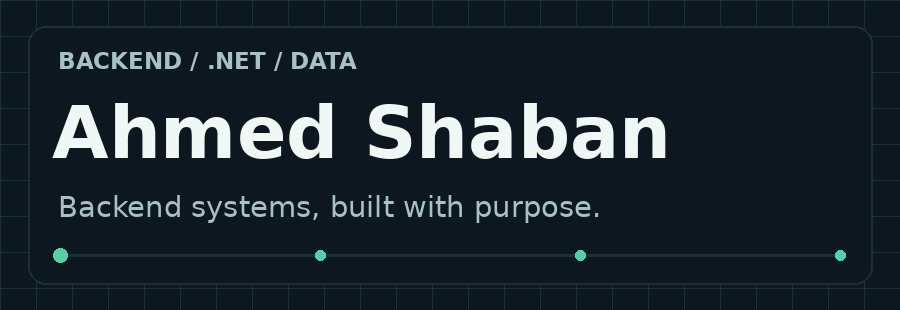
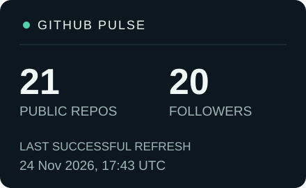

# Ahmed Shaban

**Backend Developer · .NET / SQL Server / REST APIs**

<picture>
  <source media="(prefers-color-scheme: light)" srcset="assets/2-hero-light.gif">
  
</picture>

I build backend systems for real business workflows. At **National Quality**, I work on ERP features with ASP.NET Core, Web API and SQL Server, from database logic to application features.

**Giza, Egypt · Open to relocation · Cairo University, Computer Science & AI graduate**

[LinkedIn](https://www.linkedin.com/in/ahmed-shaban-8402b2246/) · [Email me](mailto:ahmedshanan2021@gmail.com) · [Explore my repositories](https://github.com/sh3boo?tab=repositories)

## 01 / What I work with

**Backend**  
`C#` `ASP.NET Core` `Web API` `MVC` `REST` `SOAP`

**Data**  
`SQL Server` `Entity Framework` `Dapper` `ADO.NET` `LINQ`

**Engineering**  
`Git` `Docker` `Kubernetes` `Azure` `CI/CD` `Agile`

Explore my wider toolkit

- **Languages:** C++, Java, Python, JavaScript and SQL.
- **Web & application projects:** Django, Spring Boot, React and Flutter.
- **Database work:** Schema design, stored procedures, functions and query optimization.
- **Delivery:** Azure DevOps, code reviews, DevExpress and Scrum.

## 02 / Selected projects

### Plantopia · Graduation project
Plant health checks from images using an AI model, paired with a plant e-commerce experience.

`ASP.NET Core` `REST API` `Entity Framework` `Flutter`

[Explore the project →](https://github.com/sh3boo/Plantobia)

### Clinica · Doctor appointments
A booking application for finding doctors by specialty, location and availability.

`ASP.NET Core` `Web API` `SQL Server` `React`

[Explore the project →](https://github.com/sh3boo/Clinica)

### Orders & Notifications · Backend services
REST APIs for customer accounts, product orders and notifications.

`Java` `Spring Boot` `REST API`

[Explore the project →](https://github.com/sh3boo/Orders_and_Notifications_Management)

More projects: student affairs, C++ and e-commerce

- [Student Affairs Website](https://github.com/sh3boo/Student_Affairs_Website): Student information, department assignments and status changes using Django.
- [Library System](https://github.com/sh3boo/Library_System): A C++ library management application with file-based storage.
- [Ecommerce](https://github.com/sh3boo/Ecommerce): A .NET project using Docker and microservices.

The linked repositories include collaborative projects and forks. They are presented as project work, not as claims of sole authorship.

## 03 / Experience, beyond the code

### National Quality · Full-Stack .NET Developer
**Jul 2025 - Present · Full-time, on-site**

I develop and maintain ERP features using ASP.NET Core MVC, Web API and SQL Server. My work includes database queries, stored procedures, performance improvements and backend business logic.

Explore the ERP work

- **People & stock:** HR workflows for 100+ employees and warehouse inventory covering 5,000+ items.
- **Business operations:** Sales, purchasing, production, concrete operations and maintenance.
- **Finance & integrations:** Cash-in/cash-out workflows, Salla order synchronization and Banque Misr payroll transfers.
- **Data access & reporting:** Entity Framework, Dapper, ADO.NET and DevExpress.

Yandex · AI Model Trainer · Jul 2024 - May 2026

Part-time AI model training work on Yango Play's Yasmina. Achieved over 22,000 quota points and received two performance awards.

This was AI training work, separate from my .NET development role.

DEPI · Full-Stack .NET internship · Apr - Nov 2024

Practical full-stack .NET web development training through the Digital Egypt Pioneers Initiative.

Education & certifications

**Computer Science and Artificial Intelligence, Cairo University**  
Oct 2021 - Jun 2025

- Microservices Architecture with .NET Core, May 2026.
- HCIA-AI, Huawei & Egyptian Ministry of Communications, Aug 2024.
- C++ Intern Certification, Code Soft, Aug 2023.

**Languages:** Arabic, native. English, C1.

## 04 / Contribution snake

<picture>
  <source media="(prefers-color-scheme: light)" srcset="assets/6-snake-light.svg">
  
</picture>

My public contribution calendar, turned into an animation. Generated daily with [Platane/snk](https://github.com/Platane/snk), not a playable game or a live activity feed.

## 05 / GitHub pulse

<picture>
  <source media="(prefers-color-scheme: light)" srcset="assets/4-pulse-light.svg">
  
</picture>

Generated from public GitHub data, with a scheduled daily refresh. The card shows its last successful update in UTC, not a live feed. [View current repositories](https://github.com/sh3boo?tab=repositories).

---

**Working on a backend challenge?** [Let's talk.](mailto:ahmedshanan2021@gmail.com)
